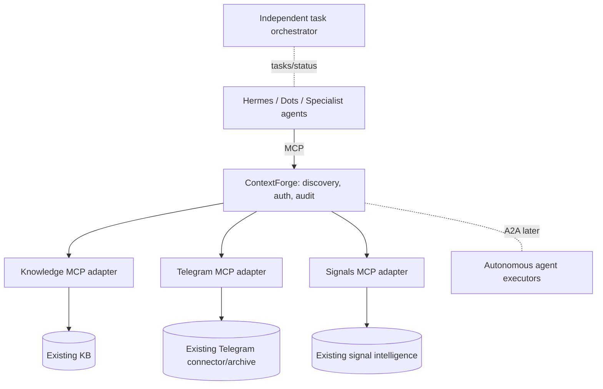

# GxG Hub — архитектурные границы

**Статус:** обзор, не свидетельство реализации. **Нормативные спецификации:** [Target Platform](specs/target-platform-v1.md), [MCP Connector Contract](specs/mcp-connector-contract-v1.md), [Toolkit](specs/mcp-toolkit-v1.md), [Service Integration](specs/service-integration-v1.md).

**Уточнение решения:** ContextForge не форкаем и не копируем — только официальный version-pinned образ. Для новых Python-коннекторов используем FastMCP, для действующих TypeScript — официальный MCP SDK. Внутренний выбор реализации и технический fallback у domain MCP-коннектора. Signals остаётся отдельным бизнес-процессом: первый вызов ContextForge при сборе, второй — для действий по ActionCandidate. Шаблон MCP и conformance suite пока **цель**, а не готовые программы.

## Компоненты

1. **Агенты:** Hermes, Dots и другие независимые исполнители; у каждого своя аутентифицированная идентичность.
2. **ContextForge:** общий шлюз, каталог и федерация MCP, грубая авторизация, управление подключениями и аудит.
3. **Доменные MCP-коннекторы:** knowledge, Telegram, signals, позже другие сервисы. Внутри — API/CLI-вызовы, нормализация ответа, допустимый технический fallback и проверка ресурса.
4. **Источники правды:** оригинальные базы знаний, архив Telegram, CRM, источники сигналов. ContextForge не копирует их содержимое как новую систему учёта.
5. **Внешний оркестратор:** отвечает за бизнес-задачи и долгоживущие процессы. Агенты оценивают семантическую достаточность результата.
6. **GxG Action Gate:** не пропускает эффекты, для которых нет валидного согласования; пока это целевой адаптер, а не готовая функция ContextForge.
7. **GxG Approval Service:** отдельный control-plane с сохраняемым запросом и решением авторизованного человека, UI согласования.
8. **MCP Toolkit:** шаблоны SDK/FastMCP, генератор и тесты контракта; пока целевой план.

## Разделение ролей

| Вопрос | Владелец |
| --- | --- |
| Можно ли этому агенту вызвать capability? | ContextForge policy, независимо проверяемая сервером |
| Можно ли прочитать именно этот Telegram-чат? | Telegram adapter, проверка ресурса |
| Каким API реализовать `telegram.search`? | Telegram adapter |
| Когда пробовать резервный технический маршрут? | Доменный adapter |
| Достаточно ли результата поиска? | Запросивший агент |
| Что делать дальше и где статус исследования? | Оркестратор / агент-исполнитель |
| Как пользоваться другим агентом как исполнителем? | Позже A2A adapter через выделенную capability |
| Кто решает, нужно ли согласование для эффекта? | GxG Action Gate и политика, не сам агент |
| Кто хранит запрос и решение человека? | GxG Approval Service |
| Кто не даёт вызвать эффект в обход согласования? | Action Gate и целевой коннектор с независимой проверкой |

## Инварианты

- Один агент не получает автоматически полномочия другого при делегировании.
- У каждой операции есть подтверждённый tenant и agent principal; никакого доверия к произвольному `agent_id` из аргументов MCP.
- Политика для действий с эффектом (сообщения, CRM, публикации) строже, чем для чтения. Не повторять отправку при неопределённом исходе.
- Для роли и прав использовать готовые механизмы ContextForge, для специфичных ресурсов — доменный адаптер; безопасная передача identity/scopes через границу должна быть доказана тестами.
- Несколько способов исполнения одной capability спрятаны внутри MCP-сервера или явно разделены на `fast` / `deep` инструменты. Технический fallback не равен смысловой оценке результата.
- A2A — следующий этап, не условие запуска MCP-first MVP.

## Согласование действий в новой платформе

Для эффекта ContextForge проверяет доступ агента к MCP-инструменту, а **GxG Action Gate** применяет policy и открывает запрос в **Approval Service**, если нужно решение человека. Бизнес-процесс приостанавливается и позднее возобновляется; длинный MCP-вызов открытым не держим. Коннектор проверяет разрешение для исходного tenant, агента, цели, хеша параметров и срока, плюс собственные права на ресурс. Пока перехват и запрет обхода не доказаны, действия с эффектом запрещены. См. [APPROVALS.md](APPROVALS.md), [MCP Contract](specs/mcp-connector-contract-v1.md) и [Toolkit](CONNECTOR_TOOLKIT.md).

## Связь со старым проектом

[Согласованное предложение](https://github.com/dmitry-v-ko/gxg_agents_v2/blob/main/docs/specs/platform/capability-hub/agent-capability-hub-our-proposal.md) и [исходная спецификация](https://github.com/dmitry-v-ko/gxg_agents_v2/blob/main/docs/specs/platform/capability-hub/README.md) остаются историей требований. Не копировать старую реализацию Hub как есть.
