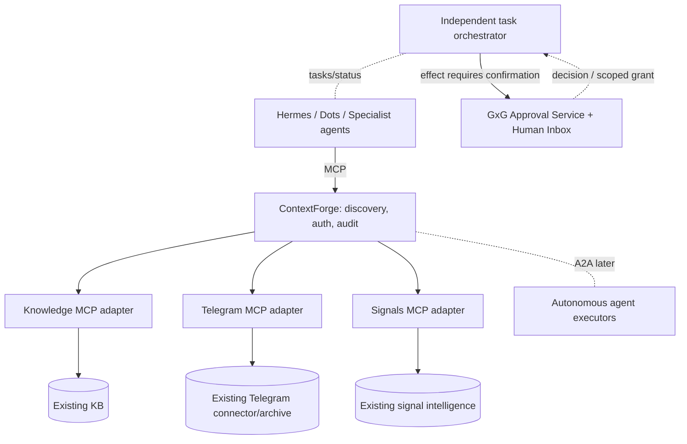

# GxG Hub — архитектурные границы

**Статус:** проектное решение, не свидетельство реализованных функций.

## Компоненты

1. **Агенты:** Hermes, Dots и другие независимые исполнители; у каждого своя аутентифицированная идентичность.
2. **ContextForge:** общий шлюз, каталог и федерация MCP, грубая авторизация, управление подключениями и аудит.
3. **Доменные MCP-коннекторы:** knowledge, Telegram, signals, позже другие сервисы. Внутри — API/CLI-вызовы, нормализация ответа, допустимый технический fallback и проверка ресурса.
4. **Источники правды:** оригинальные базы знаний, архив Telegram, CRM, источники сигналов. ContextForge не копирует их содержимое как новую систему учёта.
5. **Внешний оркестратор:** отвечает за бизнес-задачи и долгоживущие процессы. Агенты оценивают семантическую достаточность результата.
6. **GxG Approval Service (отдельный control-plane):** запросы и решения человека для опасных действий; собственное долговечное состояние и пользовательский Approval Inbox. Не часть upstream ContextForge.
7. **Toolkit + контракт:** SDK/FastMCP-шаблоны, генератор коннекторов, библиотека и обязательные тесты совместимости. См. [toolkit](CONNECTOR_TOOLKIT.md) и [contract](MCP_CONNECTOR_CONTRACT.md).

## Разделение ролей

| Вопрос | Владелец |
| --- | --- |
| Можно ли этому агенту вызвать capability? | ContextForge policy, независимо проверяемая сервером |
| Можно ли прочитать именно этот Telegram-чат? | Telegram adapter, проверка ресурса |
| Каким API реализовать `telegram.search`? | Telegram adapter |
| Когда пробовать резервный технический маршрут? | Доменный adapter |
| Достаточно ли результата поиска? | Запросивший агент |
| Что делать дальше и где статус исследования? | Оркестратор / агент-исполнитель |
| Нужно ли человеку подтверждать конкретный эффект? | Политика GxG + метаданные эффекта (не prompt агента) |
| Кто показывает запрос человеку и хранит его решение? | Отдельный GxG Approval Service / Approval Inbox |
| Кто гарантирует, что эффект не выполнится без согласования? | Проверяемый admission gate + доменный коннектор с ресурсными правами |
| Как пользоваться другим агентом как исполнителем? | Позже A2A adapter через выделенную capability |

## Инварианты

- Один агент не получает автоматически полномочия другого при делегировании.
- У каждой операции есть подтверждённый tenant и agent principal; никакого доверия к произвольному `agent_id` из аргументов MCP.
- Политика для действий с эффектом (сообщения, CRM, публикации) строже, чем для чтения. Не повторять отправку при неопределённом исходе.
- Для роли и прав использовать готовые механизмы ContextForge, для специфичных ресурсов — доменный адаптер; безопасная передача identity/scopes через границу должна быть доказана тестами.
- Несколько способов исполнения одной capability спрятаны внутри MCP-сервера или явно разделены на `fast` / `deep` инструменты. Технический fallback не равен смысловой оценке результата.
- A2A — следующий этап, не условие запуска MCP-first MVP.

## Двусторонняя интеграция Signal Intelligence

Signals **забирает источники** через ContextForge (Telegram, Web, Apify, API), затем выполняет свою оценку, сохраняет жизненный цикл задач и **вызывает действия** через ContextForge (CRM, публикация, Telegram). Контекст оценок, Action Candidate и Outcome остаются у Signals, а не в gateway. Это два независимых интерфейса к Hub, не один большой MCP-коннектор.

## Human approval в новой архитектуре

Не встраиваем очереди подтверждений, UI человека или durable workflow в ContextForge и не дублируем их в каждом MCP-сервере. Выносим в общий GxG Approval Service, доступный бизнес-процессам. При необходимости подтверждения эффект **не исполняется**: доверенный backend фиксирует запрос, получает решение авторизованного человека и возобновляет действие с доказуемым разрешением, привязанным к точным параметрам, агенту, тенанту, ресурсу и времени. ContextForge остаётся шлюзом MCP и проверкой возможности, а целевой коннектор проверяет ресурсные права и сам факт действительного разрешения. Асинхронное ожидание решения не удерживает открытым MCP-вызов. До реализации проверяемой цепочки внешние эффекты запрещены. Подробнее: [APPROVALS.md](APPROVALS.md).

## Связь со старым проектом

[Согласованное предложение](https://github.com/dmitry-v-ko/gxg_agents_v2/blob/main/docs/specs/platform/capability-hub/agent-capability-hub-our-proposal.md) и [исходная спецификация](https://github.com/dmitry-v-ko/gxg_agents_v2/blob/main/docs/specs/platform/capability-hub/README.md) остаются историей требований. Не копировать старую реализацию Hub как есть.
