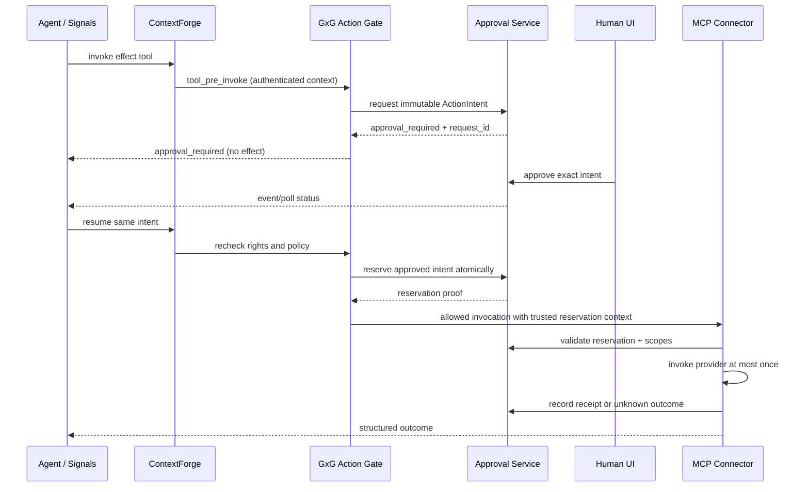

# GxG Hub — Approval State Machine v1

**Status:** normative target architecture; not implemented. This document supersedes the approval flow details in `docs/APPROVALS.md`.

## Ownership

- **GxG Action Gate** (enforcement): classify an effect and ask Approval Service to create an approval intent. No external operation is performed in `pending` state.
- **GxG Approval Service** (decision authority): persist intent and decisions, validate a human approver, manage expiry/revocation and atomic execution reservations. It does **not** send Telegram messages or mutate CRM.
- **Business workflow (Signals or another caller)**: owns task progress and resumes after a durable notification or poll. It does not keep a long MCP call open awaiting a person.
- **MCP connector**: checks the verified intent reservation and all normal resource permissions, executes or reconciles the external effect, and records provider receipt. No connector-owned approval UI.

## Required domain objects

1. `ActionIntent`: immutable `intent_id`, `tenant_id`, authenticated `requester_principal`, optional `delegated_task_id`, `tool_key`, `tool_version`, `connection_id`, `resource_id`, `canonical_args_hash`, protected `args_ref`, `effect_class`, `idempotency_key`, `policy_version`, `created_at`, `expires_at`. Never derive identity from model arguments.
2. `ApprovalRequest`: `request_id`, `intent_id`, `status`, required approver roles, optional 2-person quorum for high-risk actions, `requested_at`, `expires_at`, `decision_at`, `decision_policy_version`.
3. `ApprovalDecision`: `request_id`, authenticated `human_principal`, `tenant_id`, `decision` (`approved` / `rejected`), `decided_at`, `evidence_ref`, optional safe comment. Deny self-approval by agent principals.
4. `ExecutionReservation`: unique `(tenant_id, idempotency_key)` and `intent_id`; `state`, `reserved_by`, `reserved_at`, `lease_until`, `provider_operation_id?`, `outcome_ref?`.

## State machines

Approval request: `pending -> approved | rejected | expired | cancelled`. Decisions are terminal for the approval request. Reapproval after a changed payload is a **new request/intent**, not a state reset.

Execution: `not_started -> reserved -> dispatching -> succeeded | failed_before_effect | outcome_unknown -> reconciled_success | reconciled_failure`. A failure after dispatch must not be called `failed_before_effect` unless there is proof no external side effect occurred. Do not automatically retry `outcome_unknown`.

Approval `approved` is only a **precondition**: it is never proof the provider operation was performed.

## Protocol and human interaction (suggested API)

| API | Caller | Meaning |
| --- | --- | --- |
| `POST /v1/action-intents` | trusted Action Gate only | server-validate immutable payload + policy; return existing `intent_id` for same unique key or `approval_required` |
| `GET /v1/approval-requests/{id}` | authorized requester / approver | read own tenant's status and redacted summary |
| `POST /v1/approval-requests/{id}/decision` | authenticated human UI backend only | conditional approve/reject, MFA/role/quorum validated |
| `POST /v1/execution-reservations` | trusted Gate/connector only | atomically reserve approved intent for exact payload & scope |
| `POST /v1/execution-reservations/{id}/complete` | executor only | record durable receipt or `outcome_unknown` |
| `POST /v1/execution-reservations/{id}/reconcile` | trusted reconciler only | query provider by operation/idempotency ID; mark known outcome |

APIs above are **design contracts**, not currently implemented endpoints. A tool-facing `approval_required` outcome must be a structured, stable domain status; the MCP client should never be expected to open a human dialog in the same synchronous request.

## Critical concurrency and security invariants

- **No side effect before permission and approval.** Admission starts with tool+resource RBAC. A valid human decision cannot grant a capability the agent did not possess.
- **Atomically reserve before dispatch.** Reserve only if approval status is approved, within expiry, not revoked, exact server-calculated canonical hash matches, and no existing reservation for the idempotency key. Use a database transaction and unique constraints, not read-then-write.
- **Reservation is not an infinite lease.** After worker crash in `dispatching`, transition to `outcome_unknown` and reconcile provider status before any retry. A new worker cannot simply replay the send after lease expiration.
- **Approval is not a bearer password.** The model may supply a correlation request ID but this never grants permission. Decision lookup/reservation is authenticated service-to-service, and each downstream call rechecks tenant, principal, tool, resource and policy.
- **Canonical parameters are immutable** after human review. For Telegram include channel/chat, recipient, message text, media identifiers, attachment hashes and account. For CRM include record/account, field changes and version precondition. If any changes, request new approval.
- **No self-approval, cross-tenant approval or unrestricted token forwarding.** Human approver authentication is separate from machine credentials; high-risk policy may require MFA or independent reviewers.
- **Notifications are hints, not the source of truth.** Durable database/outbox + idempotent delivery, with recovery polling. Approval UI must fetch current status before allowing a decision.
- **Races are denied safely.** Two concurrent decision submissions, workers or retries cannot produce more than one execution reservation. Provider exactly-once cannot be guaranteed without its own dedupe; document at-most-one dispatch attempt plus reconciliation semantics.
- **Revocation:** prevent new reservations on revoked/expired approvals; if already dispatching, mark uncertain and reconcile rather than pretending cancellation can undo an external effect.

## Message sequence (proposed)

**Design warning:** tool hooks may not be able to supply a trusted, unforgeable reservation context in the deployed version. If so, implement a separate mandatory effect adapter with service-to-service authorization instead. This sequence is a target to validate, not a claim of current ContextForge behavior.

## Testable acceptance

- Approval request created only for an authorized, effect-classified tool; unknown or read-only tools follow explicit policy.
- Two concurrent workers reserving one approved intent result in exactly one successful reservation.
- Two different recipients or messages have different hashes and cannot share an approval.
- Human rejection/expiry, forged reviewer, absent MFA when policy requires it, or wrong tenant cannot authorize execution.
- Gate/plugin down or omitted, direct connector call, forged identity header, fake `approval_id` all yield zero provider calls.
- Gateway returns after `approval_required` without holding the HTTP/MCP call open.
- Crash after provider submission results in `outcome_unknown` and reconciliation, not an automatic second send.

Source: [Security and Action Gate](security-and-action-gate-v1.md); normative MCP tool contract [here](mcp-connector-contract-v1.md).