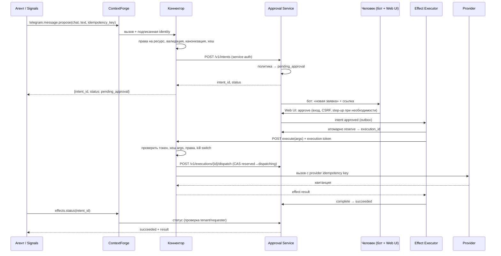

# GxG Hub — эффекты и согласование v1

**Статус:** нормативная целевая модель, не реализована. 2026-11-20. Заменяет прежние `approval-state-machine-v1.md` и схему «Action Gate в `tool_pre_invoke`».

## Принцип

**Агент не может исполнить внешний эффект. Он может только предложить его.**

1. Агент вызывает `<domain>.<object>.propose(...)`. Коннектор проверяет права, валидирует и канонизирует параметры, и Approval Service сохраняет неизменяемый **intent**.
2. Политика решает, нужно ли решение человека. Если нужно, человек получает уведомление в боте и принимает решение в Web UI.
3. **Effect Executor** атомарно резервирует одобренный intent и вызывает в коннекторе `execute`, предъявляя подписанный одноразовый **execution token**.
4. Коннектор проверяет токен, обращается к провайдеру не более одного раза и возвращает результат.
5. Агент или бизнес-сервис узнаёт результат по `intent_id`.

Почему не плагин в ContextForge: см. [Целевая платформа](target-platform-v1.md#почему-так).

## Классы эффектов и путь исполнения

| Effect class | Путь | Согласование по умолчанию | Примеры |
| --- | --- | --- | --- |
| `read` | Прямой вызов tool | Не требуется | `kb.search`, `telegram.thread.read` |
| `write_reversible` | Прямой вызов tool с `idempotency_key` и аудитом | Не требуется. Если политика tenant требует согласования, tool публикуется только в форме `propose` | Черновик в KB, внутренняя заметка |
| `external_effect` | Только `propose` → `execute` | **Требуется.** Tenant может задать правила авто-одобрения: allowlist получателей, лимиты частоты и объёма | Отправка в Telegram, запись в CRM, публикация |
| `high_risk` | Только `propose` → `execute` | **Требуется**, step-up у approver'а, по политике два approver'а. Авто-одобрение запрещено | Массовая рассылка, деньги, удаление, необратимые действия |

- **EFF-01.** Effect class задаётся в manifest tool'а ([MCC-01](mcp-connector-contract-v1.md#требования)), а не аргументом. При сомнении выбирается более строгий класс.
- **EFF-02.** Для `external_effect` и `high_risk` в каталоге ContextForge публикуется только `propose`. Tool `execute` не регистрируется в ContextForge, а правило `unified_pdp` дополнительно запрещает агентам любые `*.execute`.
- **EFF-03.** Авто-одобрение по правилу записывается как решение с `decided_by = policy:<rule_id>@<policy_version>`. Путь исполнения тот же, через Executor и токен.

## Поток



## Tools, доступные агентам

| Tool | Владелец | Назначение |
| --- | --- | --- |
| `<domain>.<object>.propose` | Коннектор | Создать intent. Возвращает `intent_id` и `status` (`pending_approval` или `approved`) |
| `effects.status` | Approval Service | Статус intent'а и результат исполнения |
| `effects.cancel` | Approval Service | Отменить свой intent, пока он не перешёл в `reserved` |

Агент видит только intents своего tenant и только те, где он requester, если политика не разрешает больше.

## Шаг 1: propose

- **EFF-04.** Коннектор перед созданием intent'а проверяет identity, права principal'а на connection и ресурс и валидность аргументов по `inputSchema`, а затем канонизирует параметры.
- **EFF-05.** Канонизация: нормализованный JSON (строки в Unicode NFC, без float для денежных сумм — целые минорные единицы или строки, вложения как SHA-256), сериализация по [RFC 8785 (JCS)](https://www.rfc-editor.org/rfc/rfc8785). Хешируется SHA-256 от `{tool_key, tool_version, tenant_id, connection_id, resource_id, args}`.
- **EFF-06.** Коннектор формирует `preview` — человекочитаемое представление эффекта для UI (получатель, полный текст, изменяемые поля CRM с diff). Preview строится из канонических args, а не из текста агента.
- **EFF-07.** Intent неизменяем. Любое изменение параметров — новый intent и новое согласование.
- **EFF-08.** Идемпотентность propose: уникальность по `(tenant_id, idempotency_key)`. Повтор с тем же хешем возвращает существующий intent, повтор с другим хешем — ошибку `conflict`. `idempotency_key` не даёт полномочий, это только ключ дедупликации. Signals передаёт `action_candidate_id:version`. Если ключ не передан, коннектор генерирует его сам, и тогда дедупликации между повторами propose нет.

Intent соответствует [effect-intent.schema.json](../../schemas/effect-intent.schema.json). Полные args хранятся в защищённом хранилище Approval Service (`args_ref`), в аудит попадает только хеш.

## Шаг 2: политика и решение человека

- **EFF-09.** Политика вычисляется в Approval Service по `tenant`, `tool`, `effect_class`, `resource`, `requester` и правилам tenant. Результат фиксируется вместе с `policy_version`. Политика может только ужесточать умолчания из таблицы выше, кроме явно разрешённых правил авто-одобрения для `external_effect`.
- **EFF-10.** Решение принимает человек с ролью `approver` в tenant intent'а. Self-approval и cross-tenant approval запрещены (SEC-07).
- **EFF-11.** Решение привязано к `intent_id` и `canonical_args_hash` и записывается условно: только если intent всё ещё `pending_approval` (оптимистичная блокировка по версии). Устаревший экран UI не может одобрить изменившийся или уже решённый intent.
- **EFF-12.** Для `high_risk` при включённом кворуме нужны два решения `approve` от разных людей. Одно `reject` отклоняет intent.

### Уведомление и UI

- **EFF-13. Notify-бот** — отдельный Telegram-бот, а не пользовательская сессия Telegram-коннектора. Он присылает approver'у: tenant, tool, кто запросил, короткое описание, срок и ссылку в Web UI. Бот не умеет одобрять: кнопки в нём только открывают UI. Привязка Telegram-аккаунта к approver'у делается одноразовым кодом из UI.
- **EFF-14.** Уведомление — подсказка, а не источник истины. Если бот недоступен, заявки всё равно видны в UI в списке «ожидают решения».
- **EFF-15. Approval Web UI:**
  - вход через OIDC или passkey, сессия с `HttpOnly`/`Secure`/`SameSite=Strict` cookie, CSRF-токен на каждое решение;
  - карточка показывает preview, точные канонические параметры, requester'а, `business_task_id`, причину согласования (правило политики), срок;
  - для `high_risk` — step-up повторной аутентификацией перед решением;
  - массового одобрения для `external_effect` и `high_risk` в v1 нет;
  - перед отправкой решения UI перечитывает текущий статус.

## Шаг 3: исполнение

- **EFF-16.** Executor забирает одобренные intents из outbox Approval Service и **атомарно резервирует** исполнение в одной транзакции. Условия: intent `approved`, не истёк, не отменён, kill switch не активен, нет активного исполнения. Обеспечивается уникальным ограничением, а не схемой «прочитать, потом записать».
- **EFF-17.** Executor читает args из защищённого хранилища, выпускает execution token и вызывает `execute` коннектора по внутренней сети.
- **EFF-18.** Коннектор в `execute` MUST:
  1. проверить подпись токена (известный `kid`), `iss`, `aud` = свой ID, `exp`, отсутствие `jti` в локальном кеше;
  2. пересчитать хеш полученных args и сравнить с `ahs`;
  3. проверить, что `tool`, `connection`, `resource` и `tenant` из токена соответствуют его конфигурации, и что права requester'а на ресурс не отозваны;
  4. проверить kill switch;
  5. вызвать `POST /v1/executions/{id}/dispatch` — атомарный переход `reserved → dispatching`. Только успешный ответ разрешает обращение к провайдеру;
  6. вызвать провайдера один раз, передав `idempotency_key`, если провайдер поддерживает идемпотентность.
- **EFF-19.** Коннектор возвращает результат по [effect-result.schema.json](../../schemas/effect-result.schema.json). Executor записывает его через `complete`.

### Execution token

JWS (EdDSA/Ed25519), compact serialization, `typ: gxg-exec+jwt`.

| Claim | Значение |
| --- | --- |
| `iss` | `gxg-executor` |
| `aud` | ID коннектора |
| `sub` | `intent_id` |
| `jti` | `execution_id` (уникален на попытку) |
| `ten` | `tenant_id` |
| `req` | requester principal |
| `tool` | `tool_key@tool_version` |
| `con` | `connection_id` |
| `res` | `resource_id` |
| `ahs` | `canonical_args_hash` |
| `idk` | `idempotency_key` |
| `iat`, `exp` | `exp − iat ≤ 60 с` |

- **EFF-20.** Токен — не единственная защита от повторов. Одноразовость обеспечивает CAS `dispatch` в Approval Service, локальный кеш `jti` — дополнительный слой.
- **EFF-21.** Токен не передаётся агенту, не логируется и не попадает в ответы tools.

## Состояния intent'а

```text
pending_approval ──approve──> approved ──reserve──> reserved ──dispatch──> dispatching
      │                          │                     │                    │
      ├─reject──> rejected       ├─cancel/expire──> cancelled/expired       ├─> succeeded
      ├─expire──> expired        │                     │                    ├─> failed_before_effect ──(retry ≤ N)──> reserved
      └─cancel──> cancelled      │                     └─lease─> approved*  └─> outcome_unknown ──reconcile──> reconciled_succeeded
                                                                                                           └──> reconciled_failed
```

\* Резервирование без `dispatch` по истечении lease возвращается в `approved`: провайдер не вызывался, так что это безопасно.

- **EFF-22.** Авто-одобренный intent переходит сразу в `approved`.
- **EFF-23.** `failed_before_effect` ставится только при доказательстве, что провайдер не получил запрос: ошибка до отправки или явный отказ провайдера без эффекта. Повтор допустим не более `max_attempts` раз (по умолчанию 3) в пределах окна исполнения, с новым `execution_id` и тем же `idempotency_key`.
- **EFF-24.** Таймаут, обрыв или падение после `dispatch` дают `outcome_unknown`. Автоматического повтора нет.
- **EFF-25.** Reconciliation: Executor вызывает `reconcile` коннектора (поиск операции у провайдера по `idempotency_key` или `provider_operation_id`). Если провайдер не позволяет проверить, intent остаётся `outcome_unknown` и показывается в UI для ручного разбора. Человек отмечает исход с обоснованием.
- **EFF-26.** Отмена и отзыв действуют до `reserved`. После `dispatching` отменить эффект нельзя, можно только зафиксировать исход.
- **EFF-27.** `approved` — только предусловие. Статус эффекта определяют `succeeded` / `reconciled_succeeded` с квитанцией провайдера.

## Сроки по умолчанию

| Параметр | Значение | Где меняется |
| --- | --- | --- |
| Ожидание решения (`pending_approval` → `expired`) | 24 ч | Политика tenant/tool |
| Окно исполнения после одобрения | 1 ч | Политика |
| Lease резервирования | 5 мин | Конфигурация Executor |
| Срок execution token | 60 с | Конфигурация Executor |
| `max_attempts` для `failed_before_effect` | 3 | Политика tool |

## Уведомление requester'а

- **EFF-28.** Источник истины — `effects.status`. Бизнес-сервис MAY подписаться на подписанные webhooks смены статуса (dedupe по `intent_id` + `status`), но MUST уметь восстанавливаться опросом.
- **EFF-29.** MCP-вызов `propose` возвращается сразу. Hub не держит соединение в ожидании человека.

## Внутренний API Approval Service

| Endpoint | Кто вызывает | Назначение |
| --- | --- | --- |
| `POST /v1/intents` | Коннектор (service auth + identity requester'а) | Создать intent или вернуть существующий |
| `GET /v1/intents/{id}` | ContextForge → `effects.status`, UI | Статус и результат с проверкой tenant и роли |
| `POST /v1/intents/{id}/cancel` | Requester через `effects.cancel`, approver | Отмена до `reserved` |
| `POST /v1/intents/{id}/decisions` | Backend Web UI (сессия человека) | Approve/reject с условием по версии |
| `POST /v1/executions/{id}/dispatch` | Коннектор (по execution token) | Атомарный CAS `reserved → dispatching` |
| `POST /v1/executions/{id}/complete` | Executor | Зафиксировать результат |
| `GET /v1/switches` | Коннектор, Executor | Состояние kill switch |

Это проектный контракт. OpenAPI появится вместе с реализацией.

## Связь с Signals

`ActionCandidate` в Signals отображается на intent через `business_task_id = action_candidate_id` и `idempotency_key = action_candidate_id:version`. Signals остаётся владельцем кандидата и `Outcome`, а результат получает через `effects.status` или webhook. Подробнее: [Интеграция сервисов](service-integration-v1.md#signal-intelligence).

## Схемы

Уже есть: [effect-intent](../../schemas/effect-intent.schema.json), [effect-result](../../schemas/effect-result.schema.json).
Нужно добавить: `execution-token.schema.json` (claims), `intent-status.schema.json` (ответ `effects.status`), `approval-decision.schema.json`.
