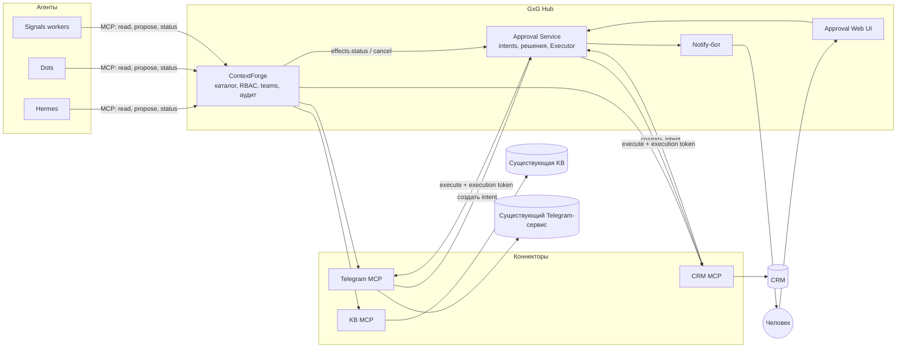

# GxG Hub — целевая платформа v1

**Статус:** целевая архитектура, не реализована. 2026-11-20.

## Назначение

Hub даёт нескольким независимым агентам доступ к возможностям (KB, Telegram, Signals, CRM, внешние API) через один MCP-интерфейс, с правами по tenant, агенту и конкретному ресурсу. Эффекты исполняются только через контролируемый путь «предложить → согласовать → исполнить».

Hub не хранит бизнес-данные, не оценивает качество ответов и не оркеструет бизнес-процессы.

## Компоненты



| Компонент | Владеет | Не владеет |
| --- | --- | --- |
| **ContextForge** (upstream, без форка) | Каталог tools, маршрутизация к MCP-серверам, аутентификация агентов, teams и RBAC, базовая политика (`unified_pdp`), аудит вызовов | Согласованием, исполнением эффектов, бизнес-логикой, данными |
| **Коннектор** | Вызовами backend/провайдера, проверкой прав на конкретный ресурс, техническим fallback, валидацией и канонизацией параметров эффекта, исполнением по execution token | Решением человека, собственным approval UI, бизнес-процессом |
| **Approval Service + Effect Executor** | Intents, политикой согласования, решениями людей, атомарным резервированием, выпуском execution token, reconciliation, kill switch эффектов | Provider credentials, доменной логикой, бизнес-процессом |
| **Approval Web UI + notify-бот** | Показом заявки человеку, аутентификацией человека, приёмом решения | Самим решением: оно записывается в Approval Service |
| **Агент** | Постановкой подзадачи, выбором инструмента, оценкой достаточности результата | Выдачей себе прав, исполнением эффекта напрямую |
| **Бизнес-сервис / оркестратор** (Signals и др.) | Своими данными, долгими процессами, задачами, Outcome | Общим каталогом MCP, политиками доступа |
| **Существующие backend'ы** | Данными, сессиями, provider credentials | Глобальной политикой MCP |

Подробности: доверие — [Security](security-v1.md), эффекты — [Эффекты и согласование](effects-and-approval-v1.md).

## Почему так

- **ContextForge используется для того, что в нём есть.** В нём есть каталог, teams, RBAC, `unified_pdp` с deny-by-default и плагины. Встроенного согласования человеком нет, а плагин `tool_pre_invoke` не может приостановить вызов в ожидании человека: у плагина таймаут, механизма pending нет (VERIFY на закреплённой версии). Поэтому согласование — отдельный наш сервис, а не плагин.
- **У агента нет инструмента «исполнить».** Агент вызывает только `*.propose`. Исполняет Executor, предъявляя коннектору подписанный токен. Безопасность эффекта не зависит от того, перехватит ли ContextForge каждый путь вызова: без токена коннектор ничего не исполнит. Плагины ContextForge остаются дополнительным слоем.
- **Минимум своего инфраструктурного кода.** Наш код — Approval Service с Executor, небольшой UI и бот, коннекторы и toolkit. Всё остальное — ContextForge и MCP SDK.

## Tenancy

Модель — **оператор и несколько клиентов** (до ~10 tenant'ов в ближайший год). Клиенты не настраивают Hub сами: интеграции, агентов и политики заводит оператор.

- **TEN-01.** Tenant = team в ContextForge. Проверено на v1.1.1 в [спайке M4](../adr/0001-identity-propagation.md#результаты-по-критериям). Gateway, tools и virtual servers с visibility `team` видны только участникам этой team: в `tools/list`, `/v1/tools`, `/v1/servers` ([доказательство](../../spikes/m4-contextforge/evidence/teams-claims-and-visibility.json)). Вызов tool'а чужой team отклоняется на `/rpc` и `/servers/{id}/mcp` до обращения к upstream. Глобальный `/mcp` на v1.1.1 отказывает team-scoped токену агента для любого tool, в том числе своей team (RBAC `tools.execute`), поэтому изоляцию он не доказывает и при обновлении ContextForge проверяется заново. Team-scoped токен агента несёт `teams` = [`<team_id>`] (SEC-02). `team_id` — UUID ContextForge, имя tenant'а (`t-alpha`) — slug team. Соответствие `team_id` → tenant хранится в реестре платформы. Каждый агент принадлежит ровно одному tenant.
- **TEN-02.** У каждого tenant свои connections и provider credentials. Коннектор выбирает credentials только по проверенному tenant, никогда по аргументу.
- **TEN-03.** Общие шаблоны коннекторов можно публиковать для всех tenant'ов, но публикация не означает выдачу доступа: tools конкретного tenant видимы только его команде.
- **TEN-04.** Изоляция проверяется на каждом слое: ContextForge (видимость и вызов), коннектор (ресурс и credentials), Approval Service (intent, решение и approver того же tenant).
- **TEN-05.** Оператор (`platform_admin`) управляет конфигурацией всех tenant'ов, но не является approver'ом клиента по умолчанию. Право согласовывать в tenant выдаётся явно.
- **TEN-06.** Агентов «на несколько tenant'ов» нет. Если операторскому агенту нужна работа в нескольких tenant'ах, у него отдельный principal и credential в каждом (`agent:<tenant>:<name>`). Так права одного tenant'а не могут случайно примениться в другом.

Self-service, биллинг и клиентские админки в v1 не делаем.

## Роли

| Роль | Кто | Может |
| --- | --- | --- |
| `platform_admin` | Оператор | Регистрировать серверы и tools, tenant'ов, агентов, политики; включать и выключать эффекты |
| `tenant_admin` | Ответственный клиента или оператор | Управлять агентами и approver'ами своего tenant (в v1 фактически оператор) |
| `approver` | Человек с правом согласования в tenant | Одобрять и отклонять intents своего tenant в пределах политики |
| `agent` | Machine principal | Вызывать выданные tools: read, `*.propose`, `effects.status`, `effects.cancel` |
| `viewer` | Наблюдатель | Читать аудит и статусы своего tenant |

Роли ContextForge (`platform_admin`, `team_admin`, `developer`, `viewer`) отображаются на эти роли. Роль `approver` живёт в Approval Service, так как ContextForge о ней не знает.

## Права

Итоговое право на вызов — пересечение:

`tenant ∩ principal ∩ tool ∩ connection ∩ конкретный ресурс ∩ effect class ∩ политика`

- ContextForge проверяет tenant, principal и tool.
- Коннектор проверяет connection и ресурс (чат, документ, CRM-аккаунт).
- Approval Service проверяет политику эффекта и решение человека.

Ни один слой не полагается на то, что проверку сделал другой.

## Несколько способов исполнения одной возможности

Выбор метода и технический fallback (локальный архив → live API) находятся **внутри коннектора**. ContextForge только маршрутизирует.

- Fallback допустим только при доказанной технической ошибке и только для безопасно повторяемых операций (MCC-06).
- Валидный пустой результат не запускает дорогой маршрут. Достаточность результата оценивает агент.
- Если дорогой метод нужно разрешать отдельно, это два tool'а: `telegram.messages.search` и `telegram.messages.search_deep`.

## Протоколы

1. **MCP-first.** Удалённые коннекторы работают по Streamable HTTP за ContextForge.
2. **Внутренние вызовы** (коннектор → Approval Service, Executor → коннектор) идут по HTTPS во внутренней сети с аутентификацией сервисов: mTLS или подписанные service tokens.
3. **События** (смена статуса intent → Signals) — подписанные webhooks с dedupe и обязательным fallback на опрос статуса.
4. **A2A** — позже, через тонкий MCP→A2A bridge с делегированными ограниченными правами.

## Развёртывание (целевое)

- ContextForge — официальный OCI-образ, закреплённый по digest, с PostgreSQL.
- Approval Service использует отдельную базу PostgreSQL. Атомарность обеспечивают транзакции и уникальные ограничения.
- В интернет не публикуется ничего. ContextForge (MCP для агентов), Approval Web UI (для людей) и админ-интерфейсы доступны только из tailnet Tailscale по HTTPS. Коннекторы, Approval Service API и базы в tailnet не входят (SEC-13, SEC-25…27, [ADR-0003](../adr/0003-network-tailscale.md)).
- `compose.yaml` в репозитории — только локальный dev-стенд.

Конкретный хостинг пока не выбран. Сетевой доступ снаружи — Tailscale при любом хостинге. Хостинг влияет на реализацию внутренней изоляции, но не на требования к ней ([Security](security-v1.md#сеть)).

## Структура репозитория (целевая)

```text
docs/specs/        нормативные спеки
schemas/           машиночитаемые контракты (JSON Schema)
tests/contract/    общие контрактные тесты
templates/         шаблоны коннекторов (TODO)
scripts/           генератор и проверка коннекторов (TODO)
connectors/        коннекторы
approval/          Approval Service, Executor, UI, бот (TODO)
policies/          политики без секретов
compose.yaml       dev-стенд
```
